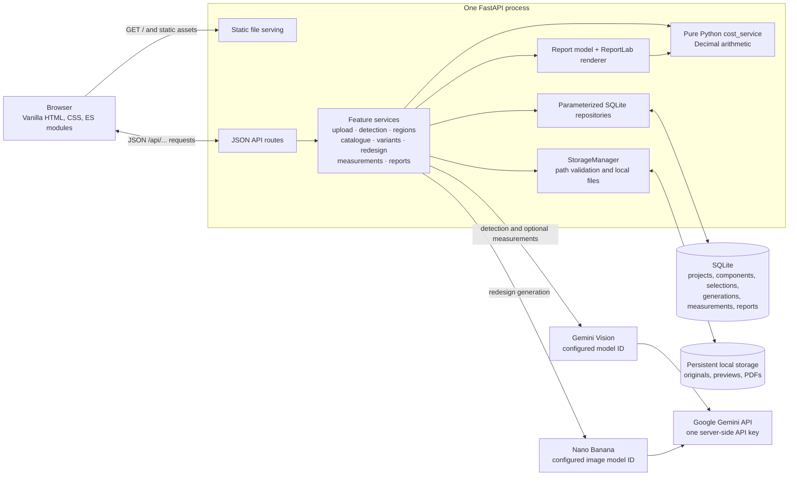

# System architecture

## High-level system



The browser is a vanilla JavaScript single-page interface served by the same FastAPI application as the JSON endpoints. Route handlers delegate to business services; repositories contain parameterized `sqlite3` operations. `StorageManager` validates paths under the configured storage root.

The Vision and image-generation capabilities are separate Google GenAI `GenerateContent` integrations, with separate configurable model IDs and the same server-side `GEMINI_API_KEY`. The Vision model interprets the original exterior photograph or 3D architectural rendering for component detection and optional approximate measurements. Clear renderings are supported; rendering-derived dimensions are still unverified physical estimates. Nano Banana creates the visual redesign from the original image and selected-region instructions. Neither AI integration computes costs.

`cost_service.py` is deterministic Python using `Decimal` arithmetic. The PDF service builds a plain report model from the same estimate service and renders it with ReportLab. The process uses one SQLite database and local storage; there are no workers, microservices, frontend frameworks, or build step.

## End-to-end request and data flow

```mermaid
sequenceDiagram
    actor Homeowner
    participant Browser as Vanilla frontend
    participant API as FastAPI application
    participant Upload as Upload and storage services
    participant Detect as Detection service
    participant Vision as Gemini Vision
    participant DB as SQLite repositories
    participant Files as StorageManager / local files
    participant Catalogue as Catalogue and selection services
    participant Redesign as Redesign service
    participant Nano as Nano Banana
    participant Measure as Measurement service
    participant Cost as Python cost_service
    participant Report as Report service / ReportLab

    Homeowner->>Browser: Create project and choose exterior photo or rendering
    Browser->>API: POST project and photo
    API->>Upload: Validate type, dimensions, limits
    Upload->>Files: Save original exterior image securely
    Upload->>DB: Insert photo and project data atomically
    Upload-->>Browser: Photo resource

    Homeowner->>Browser: Request component detection
    Browser->>API: POST detect
    API->>Detect: Create stage run and prepare working image
    Detect->>Vision: Original-image derivative plus detection prompt
    Vision-->>Detect: JSON response
    Detect->>Detect: Validate envelope and normalize valid components
    Detect->>DB: Persist stage result and components; preserve locked edits
    Detect-->>Browser: Components and warnings

    Homeowner->>Browser: Correct regions and select materials
    Browser->>API: Component edits and selection PUTs
    API->>Catalogue: Derive compatibility and validate selection
    Catalogue->>DB: Persist component corrections and variant selections
    Catalogue-->>Browser: Saved resources and warnings

    Homeowner->>Browser: Generate redesign
    Browser->>API: POST generation
    API->>Redesign: Build selected-region prompt and fingerprint
    Redesign->>Nano: Original-photo derivative and prompt
    Nano-->>Redesign: Generated image
    Redesign->>Files: Save generated image securely
    Redesign->>DB: Record generation and complete stage run
    Redesign-->>Browser: Generation status and preview URL

    Homeowner->>Browser: Enter measurements
    Browser->>API: Measurement and rate requests
    API->>Measure: Validate and persist user values
    Measure->>DB: Save measurement source and project rates
    Browser->>API: GET estimate
    API->>Cost: Recompute quantities, ranges, and costs
    Cost-->>API: Deterministic estimate
    API-->>Browser: Estimate with missing-measurement warnings

    Homeowner->>Browser: Generate PDF report
    Browser->>API: POST report
    API->>Report: Assemble report model
    Report->>Cost: Reuse estimate service
    Cost-->>Report: Same estimate values as the screen
    Report->>Report: Render PDF with ReportLab
    Report->>Files: Save immutable report
    Report->>DB: Insert report record and complete stage run
    API-->>Browser: Report and download URL
    Homeowner->>Browser: Download PDF
```

Measurements are entered against the original image's components; an optional AI-assisted measurement also uses only the original exterior photo or rendering. Rendering-derived dimensions are not verified physical measurements and need a known scale or on-site verification. A generated redesign is never an input to measurement or costing. Estimate and report generation do not call an AI model.

## Data and deployment boundaries

- Persist both the configured SQLite database path and the complete `STORAGE_ROOT`. They must survive restarts and deployments together.
- Keep the Gemini key on the server. Protect any public or shared deployment with authentication or network access controls; CORS is not an authorization boundary.
- Set production `ALLOWED_ORIGINS` to explicit trusted origins. Do not expose a paid Gemini key through an unrestricted public instance.
- Use the platform-provided host and port as Uvicorn command-line arguments. Deployment is intentionally not tied to a provider.
